# MC Panel

[العربية](README.md) | **English**

A web control panel for managing a Minecraft (Paper/Spigot) server from the browser instead of logging in over SSH every time. It controls the server through a tmux session and streams the console and log live over WebSocket.

Compatible with every Minecraft version from **1.13 up to 26.3** and newer (updated for the latest release, 26.3). The panel itself does not depend on the game version, and it reads player files in both the old and new layouts (the new `players/` folder in 26.1+ and the old `playerdata/`).

One codebase with two interface languages, Arabic (RTL) and English (LTR), driven by language files in `locales/`. Adding a language means adding one JSON file.

## Features

- Start, stop and restart the server
- Automatic restart if the server dies on its own (crash, OOM, etc.), with no restart when the stop was requested from the panel
- Live console: send commands and follow the log in real time
- Live stats every second: TPS, RAM and CPU usage, uptime
- Player management: op, deop, ban, kick, pardon
- View the operators (ops), banned players and whitelist lists
- Full file manager: browse, open and edit, upload, download, delete. Access is confined to the server folder
- Backups: create (worlds + server.properties + ops/whitelist/bans), restore, delete, download. The archive is taken after `save-all flush` with autosave paused, so the world is consistent
- **Users with fine-grained permissions**: every feature in the panel is its own permission (about 34 in 9 sections: server, console, players, files, backups, scheduled tasks, plugins, settings, panel administration). You tick exactly what each user may do; the presets (viewer / moderator / administrator) are only a shortcut that fills the boxes, and you adjust afterwards. Enforced on the server for every request and effective immediately; console commands are checked one by one against their permission. A user who may manage users cannot grant what they do not hold. The owner is the `.env` account, holds everything and cannot be deleted. An **activity log** records sign-ins, commands, file, backup, settings and user changes, plus failed and denied attempts (never passwords or file contents). The WebSocket connection requires a signed-in session as well
- **History charts** for TPS, memory, CPU, players and free disk over the last 24 hours (one point per minute, kept in `.panel-history.json`), drawn without any chart library
- **Alerts** to Discord and Telegram: unexpected stop, start, low TPS, high memory, low disk, with a cooldown between repeats. The Discord URL is restricted to discord.com hosts and keys are never returned in full by the API
- **External backups** under Backups → External backups: **Backblaze B2**, Amazon S3 and compatibles (Wasabi, Cloudflare R2, MinIO, DigitalOcean), SFTP, FTP, WebDAV (Nextcloud), Google Drive, Dropbox, Azure Blob, or any rclone remote you already have. Add one or more destinations, test the connection with a button, then choose for each manual backup or scheduled task where it goes and whether a local copy stays, optionally keeping only the newest N backups at the destination. Needs rclone installed on the server. Your keys reach rclone through environment variables, never on the command line, and are never sent back to the browser
- **Two-factor authentication (TOTP)** per account (Google Authenticator, Authy...), with replay protection, plus a `COOKIE_SECURE` option for deployments behind HTTPS
- **Plugin manager**: list installed plugins (name and version read from `plugin.yml`), enable/disable/delete, and **search and install from Modrinth** with a version compatible with your server and hash verification before the file is kept
- **Server version and update**: shows the current Minecraft version and Paper build, checks PaperMC for updates, and with one click makes a backup, stops the server, swaps the jar (the old one is kept in `.panel-old-jars`) and starts it again. You can also download any version or a **specific build** with checksum verification, and `eula=true` is written only if you explicitly accept
- **Timed bans** with length and reason: the ban is lifted automatically when time is up (even across panel restarts)
- **Scheduled tasks** that run on the server even when the page is closed (daily, weekly on the days you pick, monthly, repeating every N minutes/hours, **or one time only** and then finished; cron for advanced users): backups that keep the last N, restarts with an in-game countdown, commands and broadcasts. Stored in `.panel-schedule.json`, no new dependencies and negligible memory
- Edit server.properties and memory/JVM settings (Xms, Xmx, G1GC, extra flags) straight from the UI
- Single-user login, bcrypt-hashed password, with a limit on failed attempts
- Dark and light themes
- The internal `tps` and `list` commands (used to refresh TPS and the player list) are hidden from the console, their result goes straight to the UI
- Permanent log of everyone who ever joined (not only who is online now), with an "All players" tab
- A dedicated player details page: health and XP with Heal/Feed/Kill buttons, inventory, armor and offhand with real in-game icons, a separate ender chest, location, full statistics, a death and teleport history, and selective deletion of player data (inventory/ender chest/XP/statistics/advancements/panel history). Live data for online players (including statistics) and the death/teleport history need the bundled PanelDataLogger plugin (see below)
- File manager: the whole row is clickable to open, secondary actions (download, rename, delete) live in a ⋮ menu
- Extended server.properties editor covering about 50 categorized properties, plus an "Extra properties" section that edits any other key without opening the file manager

## Requirements

- Linux with tmux installed
- Node.js 18 or newer
- A Java version suitable for the Minecraft server you run (for example Java 21 for 1.21.x and Java 25 for 26.x). The panel itself only needs Node.js, not Java
- A ready Paper/Spigot server (any version from 1.13 up, the example in `.env` is 26.3): the jar and the worlds already sitting in a folder on the machine

The panel does not download or set up a Minecraft server for you, it only manages an existing one.

## Installation

```bash
git clone https://github.com/tlomts-dev/mcpanel panel
cd panel
npm install
cp .env.example .env
```

Then open `.env` and edit the values, especially `MC_DIR` (the real Minecraft server path), `MC_JAR` (the jar file name) and `ADMIN_PASS`.

> **Updating an existing install?** After `git pull`, run `npm install` again: a dependency (`prismarine-nbt`) was added for reading player files. Without it the panel still works, only the inventory/current-location tab of the player details page is disabled with an explanatory message.
>
> For live data of **online** players (instant inventory/location/health with no waiting for a save), install the bundled `PanelDataLogger` plugin (see its section below) and set `PANEL_HTTP_PORT` in `.env` to match its port. Without it, this data is read from the last saved file only.

## Running

```bash
npm start                 # default language from PANEL_LANG (ar if unset)
PANEL_LANG=en npm start   # English as the default language
```

The interface ships in Arabic (RTL) and English (LTR) from one codebase and language files. Each user switches language from the selector in the header (or on the sign-in page), stored in a cookie; `PANEL_LANG` is only the default. Error messages from the server follow the user's language too. The panel opens on the port set in `PORT` (default 8080):

```
http://<machine-address>:8080
```

Sign in with `ADMIN_USER` and `ADMIN_PASS` from `.env`.

For permanent production use, run it under a process manager instead of directly in the terminal:

```bash
npm install -g pm2
pm2 start server.js --name mc-panel
pm2 save
```

## Environment variables

| Variable | Description | Default |
|---|---|---|
| `PORT` | Panel port | `8080` |
| `MC_DIR` | Minecraft server folder (jar and worlds), independent of where the panel lives | `/opt/minecraft` |
| `MC_JAR` | Exact file name of the server jar | `spigot-26.3.jar` |
| `TMUX_SESSION` | Name of the tmux session the server runs in | `mcserver` |
| `SESSION_SECRET` | Session encryption key. If empty, a random one is generated at each start, so everyone is logged out after every panel restart | random |
| `ADMIN_USER` | Login username | `admin` |
| `ADMIN_PASS` | Password, plain text | - |
| `ADMIN_HASH` | Ready-made bcrypt hash used instead of `ADMIN_PASS` when present | - |
| `SERVER_NAME` | Name shown in alert messages | name of the `MC_DIR` folder |
| `COOKIE_SECURE` | `true` or `auto` to send the session cookie over HTTPS only (use `auto` behind Caddy/nginx) | off |
| `PANEL_LANG` | Default interface language (`ar` or `en`) | `ar` |
| `RCLONE_BIN` | Path to the rclone binary for off-site backups | `rclone` |

Generate a `SESSION_SECRET`:
```bash
node -e "console.log(require('crypto').randomBytes(32).toString('hex'))"
```

Generate an `ADMIN_HASH` instead of storing the password in plain text:
```bash
node -e "console.log(require('bcryptjs').hashSync('your-password-here', 12))"
```

## Project layout

```
panel/
├── server.js          Express + WebSocket server with the whole API (Arabic edition)
├── lib/scheduler.js    Scheduler engine (shared by both editions)
├── lib/auth.js         Users, permissions and activity log
├── lib/monitor.js      History and alerts (shared)
├── lib/offsite.js      Off-site backups through rclone
├── lib/totp.js         TOTP two-factor (RFC 6238)
├── lib/downloads.js    Modrinth and Paper downloads (fixed hosts, hash checks)
├── lib/tempbans.js     Timed bans
├── lib/i18n.js         Language file loader and per-request translation
├── locales/            Language files: ar.json, en.json (new language = new file)
├── test/               Automated tests (`npm test`)
├── Dockerfile, docker-compose.yml
├── deploy/             systemd, Caddy and nginx
├── package.json
├── .env.example
├── public/
│   └── index.html      Panel UI (HTML, CSS and JS in one file, text from the language files)
└── screenshots/        Screenshots (ar/ and en/)

PanelDataLogger/         Optional companion Java plugin (separate Maven project, one jar that runs on every version from 1.13 to the latest)
├── pom.xml
├── README.md / README.en.md
└── src/main/...
```

## PanelDataLogger plugin: live data + death and teleport locations

This plugin (the `PanelDataLogger/` folder next to this project) has two jobs:

1. **An internal HTTP server (`127.0.0.1` only)** that serves the inventory/location/health of any **currently online** player straight from their in-memory object. It is more accurate and much faster than waiting for Minecraft to save the file to disk. Without the plugin, this data is read from the last saved file only (it may lag until the next `/save-all` or until they leave).
2. **Logging death and teleport coordinates** to the console (hidden from you, parsed automatically). This is needed separately because Minecraft writes these coordinates nowhere, neither in the console nor through the HTTP server above (which only shows the live state, not history).

Full statistics (deaths as a count, kills, distances) always work without the plugin, because they come from a separate standard stats file.

```bash
cd PanelDataLogger
mvn package   # details and pom.xml tweaks in PanelDataLogger/README.en.md
cp target/PanelDataLogger.jar /opt/minecraft/plugins/
```

After restarting the server, make sure `PANEL_HTTP_PORT` in the panel's `.env` matches `port` in `plugins/PanelDataLogger/config.yml` (both `28281` by default), then check from the machine itself:

```bash
curl http://127.0.0.1:28281/health   # Expected: {"status":"ok"}
```

Full details in `PanelDataLogger/README.en.md`.

## Screenshots

**Overview**

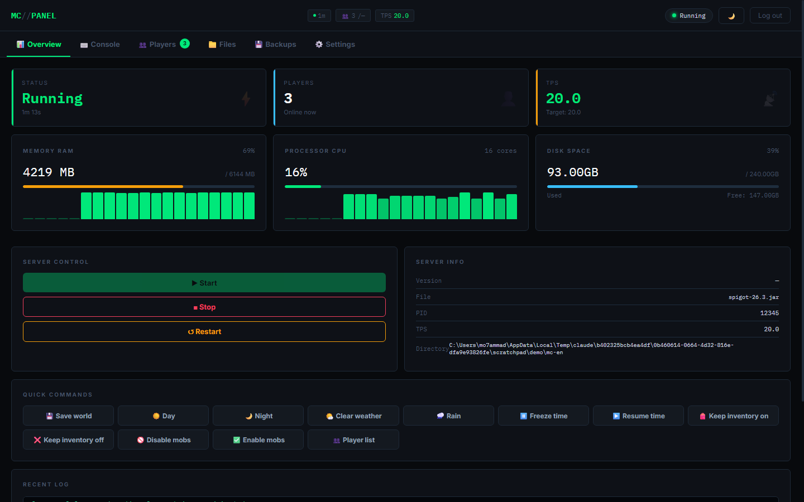

**Console**

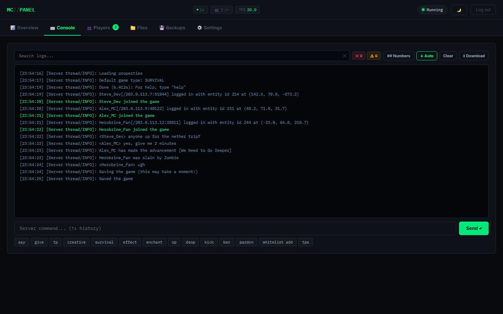

**Players**

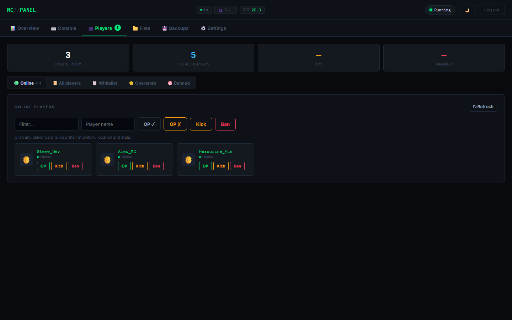

**Player details: health and XP**

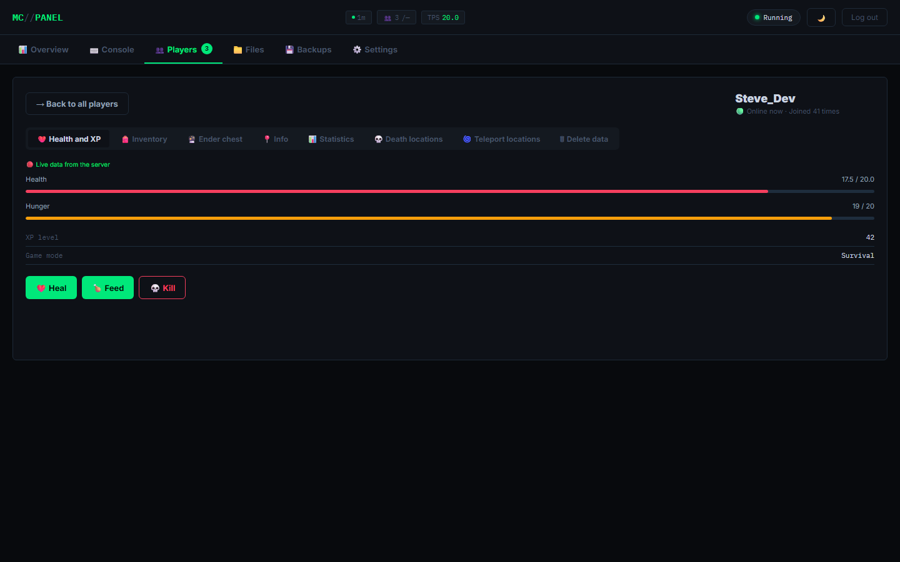

**Player details: inventory**

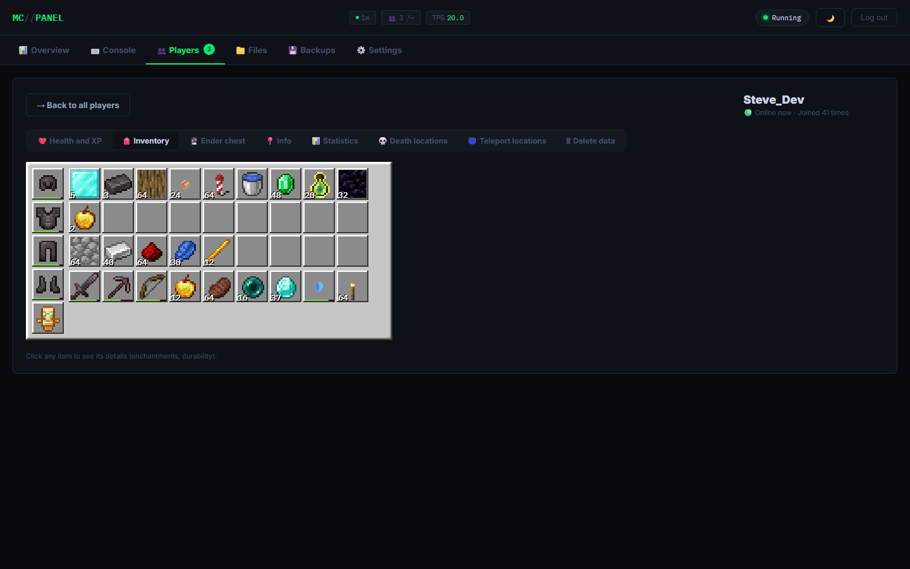

**Player details: statistics**

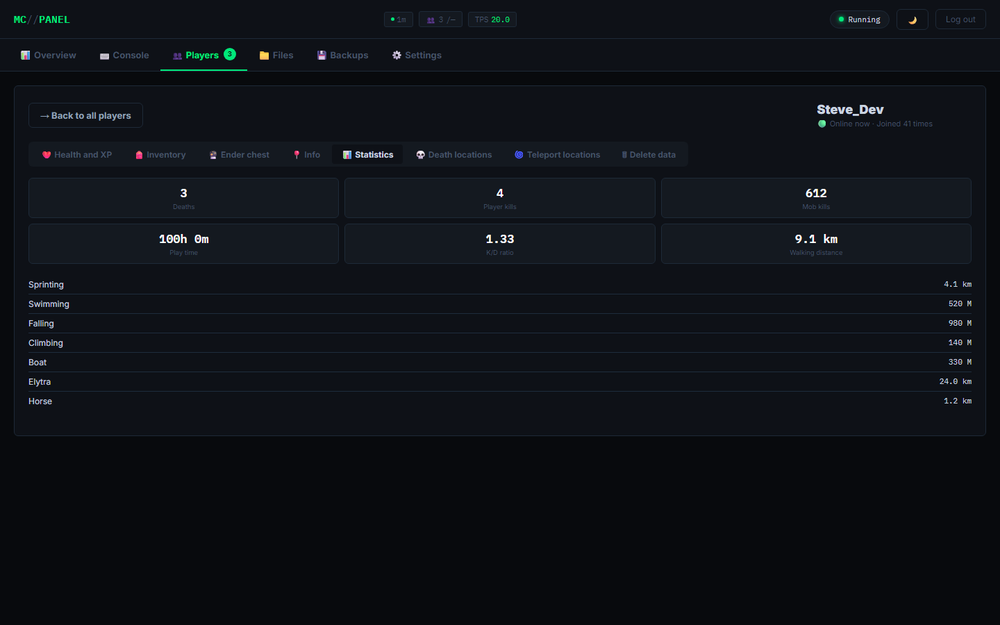

**Player details: death locations**

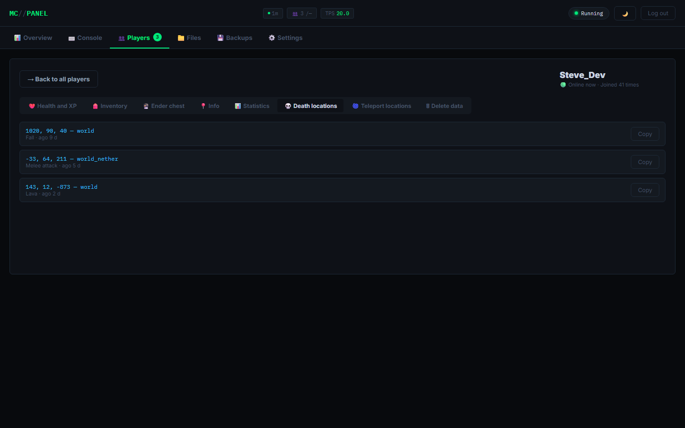

**File manager**

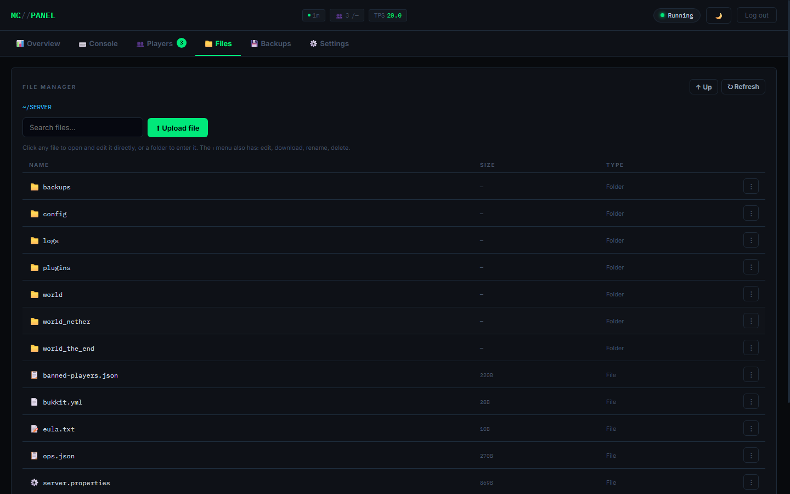

**Backups**

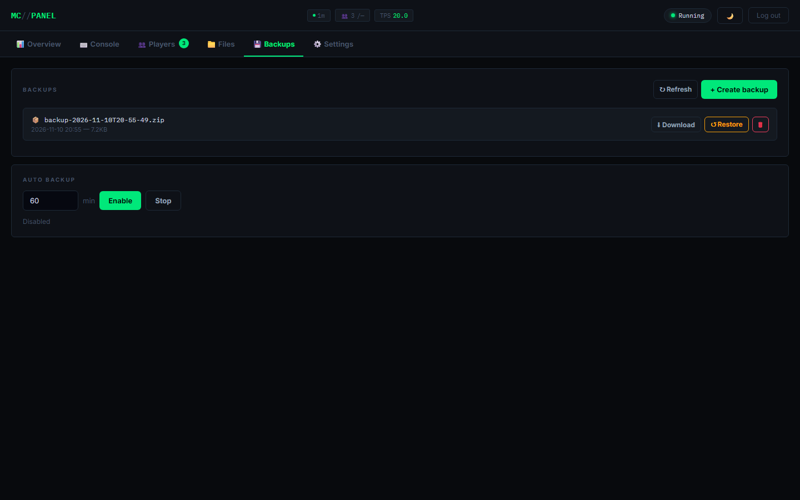

**Settings**

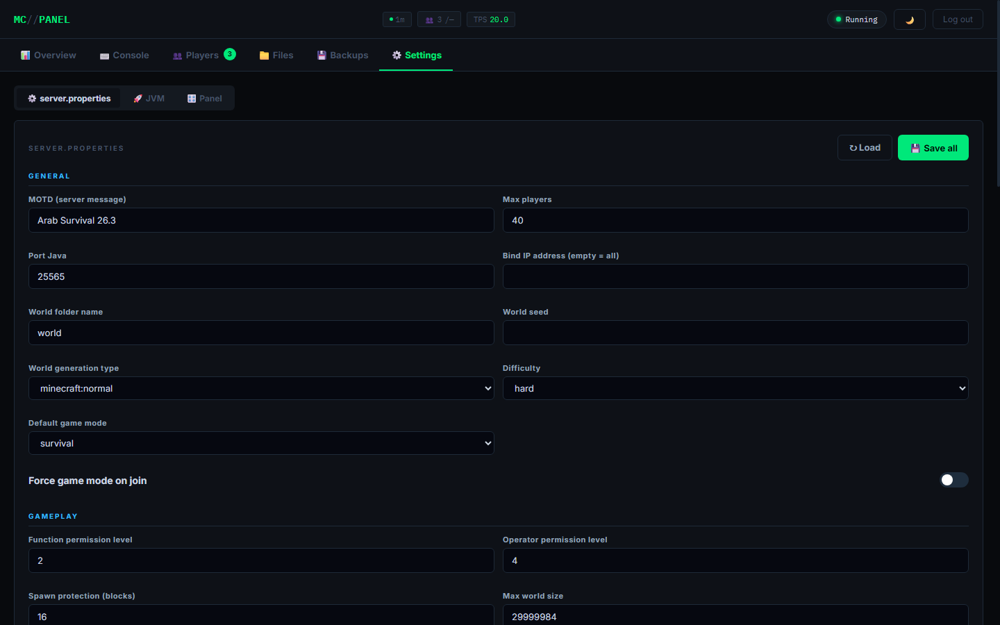

**Light theme**

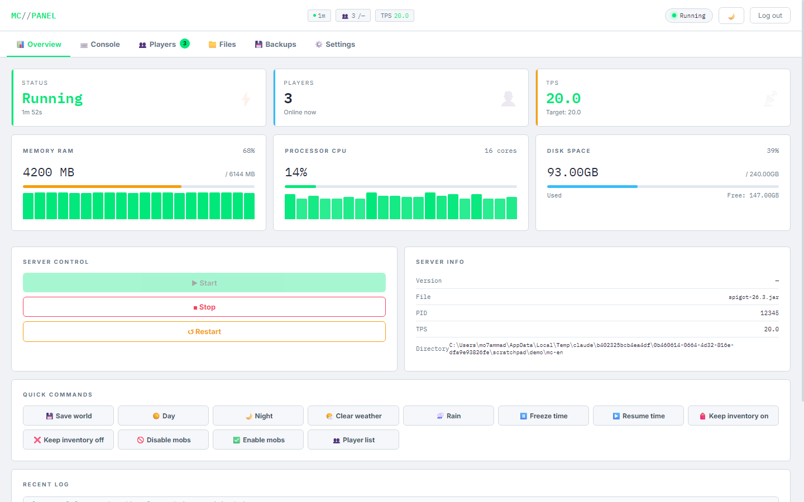

## Deployment

**Docker** (I could not build the image here because Docker is not installed on my machine, so try it before relying on it):

```bash
cp .env.example .env     # set ADMIN_PASS and SESSION_SECRET
docker compose up -d     # panel and Java in one container, data in ./data
```

The panel controls the server through tmux, so the panel and the server run in the same container. To run several servers, run one copy of the service per server with different ports and data folders.

**systemd**: copy `deploy/mc-panel.service` to `/etc/systemd/system/` and adjust the user and paths. **HTTPS**: ready templates in `deploy/Caddyfile` and `deploy/nginx.conf`; set `COOKIE_SECURE=auto` in `.env`.

**Tests**: `npm test` (GitHub Actions runs them on Node 18/20/22).

**Limits of this release**: the panel manages a single server (for a network, run one panel per server), Velocity/BungeeCord are not supported as a server type. To add a language, copy `locales/en.json` to `locales/<code>.json` and translate the values (the `meta.*` fields set direction and font).

## Security notes

The panel gives full control of the server: start and stop, deleting files, running console commands. Do not expose the port directly to the internet. Prefer a reverse proxy (nginx or Caddy) with an HTTPS certificate in front, or restrict access with a firewall or VPN.

Cookies are set `httpOnly` and `sameSite: strict`, but without an explicit `secure` flag in the code. Full protection needs real HTTPS at the reverse proxy layer.

Change the default `ADMIN_PASS` before any real use. Command filtering and the file manager include protection against path traversal and shell injection, but this does not replace restricting who can reach the panel in the first place.

## License

MIT, see the `LICENSE` file.
