# MC Panel

**العربية** | [English](README.en.md)

محدّث ليدعم أحدث إصدار من ماينكرافت: **26.3** (يعمل على Java 25).

لوحة تحكم ويب لإدارة سيرفر Minecraft (Paper/Spigot) من المتصفح، بدل الدخول بـ SSH كل مرة. تتحكم بالسيرفر عن طريق جلسة tmux، وتعرض الكونسول واللوق مباشرة عبر WebSocket.

## المميزات

- تشغيل، إيقاف، وإعادة تشغيل السيرفر
- إعادة تشغيل تلقائي لو السيرفر طاح من نفسه (كراش، OOM، الخ)، بدون إعادة تشغيل لو الإيقاف كان مقصود من اللوحة
- كونسول مباشر: إرسال أوامر ومتابعة اللوق لحظيًا
- إحصائيات لحظية كل ثانية: TPS، استهلاك الرام والمعالج (CPU)، مدة التشغيل
- إدارة اللاعبين: op، deop، ban، kick، pardon
- عرض قوائم المشرفين (ops)، المحظورين، والـ whitelist
- مدير ملفات كامل: تصفح، فتح وتعديل، رفع، تنزيل، حذف. الوصول محصور داخل مجلد السيرفر فقط
- نسخ احتياطي: إنشاء نسخة (العوالم + server.properties + ops/whitelist/bans)، استرجاع، حذف، تنزيل
- تعديل server.properties وإعدادات الذاكرة/JVM (Xms، Xmx، G1GC، فلاقز إضافية) من الواجهة مباشرة
- تسجيل دخول بمستخدم واحد، الباسورد مشفر بـ bcrypt، مع حد أقصى لمحاولات الدخول الفاشلة
- واجهة عربية بالكامل (RTL)، فيها وضع داكن ووضع فاتح
- أوامر `tps` و`list` الداخلية (لتحديث TPS وقائمة اللاعبين) لا تظهر في الكونسول، تصل نتيجتها للواجهة مباشرة
- سجل دائم لكل من دخل السيرفر (وليس فقط المتصلين الآن)، مع تبويب "كل اللاعبين"
- صفحة تفاصيل لاعب مستقلة (وليست نافذة منبثقة): الصحة والخبرة مع أزرار علاج/تغذية/قتل مباشرة، المخزون والدروع واليد الثانية بأيقونات حقيقية مطابقة للعبة، صندوق سحري منفصل، الموقع، الإحصائيات الكاملة، سجل أماكن الموت والانتقال، وحذف بيانات اللاعب بشكل انتقائي (مخزون/صندوق سحري/خبرة/إحصائيات/تقدم/سجل اللوحة) — البيانات الحية للمتصلين (بما فيها الإحصائيات) وسجل الموت/الانتقال يحتاجان إضافة PanelDataLogger المرفقة (انظر أدناه)
- مدير ملفات: الصف كامل قابل للنقر للفتح، والإجراءات الثانوية (تنزيل، إعادة تسمية، حذف) داخل قائمة ⋮
- إعدادات server.properties موسّعة تغطي نحو 50 خاصية مصنّفة في فئات، بالإضافة لقسم "خصائص إضافية" يحرّر أي مفتاح آخر في الملف دون الحاجة لفتح مدير الملفات إطلاقاً

## المتطلبات

- Linux مع tmux مثبت
- Node.js إصدار 18 فأعلى
- Java 25 أو أحدث (لتشغيل سيرفر Minecraft نفسه، الإصدار 26.x يحتاج Java 25)
- سيرفر Paper/Spigot جاهز مسبقًا (مُختبر مع إصدار 26.3): ملف jar وعوالمه موجودين في مجلد على الجهاز

اللوحة لا تُنزّل أو تُعدّ سيرفر Minecraft لك، هي فقط تدير سيرفر موجود مسبقًا.

## التثبيت

```bash
git clone https://github.com/tlomts-dev/mcpanel panel
cd panel
npm install
cp .env.example .env
```

بعدين افتح ملف `.env` وعدّل القيم، خصوصًا `MC_DIR` (مسار سيرفر Minecraft الفعلي)، `MC_JAR` (اسم ملف الـ jar)، و`ADMIN_PASS`.

> **تحديث على نسخة موجودة عندك؟** بعد `git pull` نفّذ `npm install` من جديد —
> أُضيفت تبعية جديدة (`prismarine-nbt`) لقراءة ملفات اللاعبين. بدونها تعمل
> اللوحة بشكل طبيعي، فقط تبويب "المخزون/الموقع الحالي" بصفحة تفاصيل اللاعب
> يظهر معطّلاً مع رسالة توضيحية.
>
> لبيانات اللاعبين **المتصلين** الحية (مخزون/موقع/صحة فوري بلا انتظار حفظ)،
> ركّب إضافة `PanelDataLogger` المرفقة (انظر قسمها أدناه) واضبط `PANEL_HTTP_PORT`
> في `.env` ليطابق منفذها. بدونها، تُقرأ هذه البيانات من آخر ملف محفوظ فقط.

## التشغيل

```bash
npm start          # الواجهة العربية (RTL)
npm run start:en   # English interface (LTR)
```

النسختان (العربية والإنجليزية) متطابقتان في الميزات وتعملان بنفس إعدادات `.env`. النسخة الإنجليزية موجودة في مجلد `en/`. شغّل واحدة منهما فقط على نفس المنفذ.

اللوحة تفتح على المنفذ المحدد في `PORT` (افتراضيًا 8080):

```
http://<عنوان-الجهاز>:8080
```

سجّل الدخول بـ `ADMIN_USER` و`ADMIN_PASS` من ملف `.env`.

للتشغيل الدائم في بيئة إنتاج، استخدم مدير عمليات بدل تشغيل الأمر مباشرة في الطرفية:

```bash
npm install -g pm2
pm2 start server.js --name mc-panel
pm2 save
```

## متغيرات البيئة

| المتغير | الوصف | الافتراضي |
|---|---|---|
| `PORT` | منفذ اللوحة | `8080` |
| `MC_DIR` | مجلد سيرفر Minecraft (فيه الـ jar والعوالم)، مستقل عن مكان اللوحة | `/opt/minecraft` |
| `MC_JAR` | اسم ملف jar السيرفر بالضبط | `spigot-26.3.jar` |
| `TMUX_SESSION` | اسم جلسة tmux اللي يشتغل فيها السيرفر | `mcserver` |
| `SESSION_SECRET` | مفتاح تشفير الجلسات. لو فاضي، يتولد عشوائي عند كل تشغيل، فيسجل خروج الجميع بعد كل إعادة تشغيل للوحة | عشوائي |
| `ADMIN_USER` | اسم مستخدم الدخول | `admin` |
| `ADMIN_PASS` | كلمة المرور، نص عادي | - |
| `ADMIN_HASH` | هاش bcrypt جاهز للباسورد، يستخدم بدل `ADMIN_PASS` لو موجود | - |

توليد `SESSION_SECRET`:
```bash
node -e "console.log(require('crypto').randomBytes(32).toString('hex'))"
```

توليد `ADMIN_HASH` بدل تخزين الباسورد كنص صريح:
```bash
node -e "console.log(require('bcryptjs').hashSync('كلمة-المرور-هنا', 12))"
```

## هيكل المشروع

```
panel/
├── server.js          سيرفر Express + WebSocket، فيه كل الـ API (النسخة العربية)
├── package.json
├── .env.example
├── public/
│   └── index.html      واجهة اللوحة العربية (HTML وCSS وJS في ملف واحد)
├── en/                 النسخة الإنجليزية الكاملة
│   ├── server.js
│   └── public/index.html
└── screenshots/        لقطات الشاشة (ar/ و en/)

PanelDataLogger/         إضافة Java مرافقة اختيارية (مشروع Maven منفصل، مبنية على 26.3)
├── pom.xml
├── README.md
└── src/main/...
```

## إضافة PanelDataLogger — بيانات حية + أماكن الموت والانتقال

هذه الإضافة (مجلد `PanelDataLogger/` بجانب هذا المشروع) لها مهمتان:

1. **خادم HTTP داخلي (`127.0.0.1` فقط)** يقدّم مخزون/موقع/صحة أي لاعب
   **متصل الآن** مباشرة من كائنه في الذاكرة — بديل أدق وأسرع بكثير من
   انتظار Minecraft يحفظ ملفه على القرص. بدون هذه الإضافة، تُقرأ هذه
   البيانات من آخر ملف محفوظ فقط (قد يتأخر حتى أول `/save-all` أو مغادرة).
2. **تسجيل إحداثيات الوفاة والانتقال** في الكونسول (مخفية عنك، تُقرأ آلياً)
   — ضروري بشكل منفصل تماماً، لأن Minecraft لا يكتب هذه الإحداثيات في أي
   مكان أصلاً، لا في الكونسول ولا حتى عبر خادم HTTP أعلاه (الذي يعرض
   الحالة اللحظية فقط، لا التاريخ).

الإحصائيات الكاملة (وفيات كعدد، قتل، مسافات) تعمل دائماً بدون هذه
الإضافة، لأنها تُقرأ من ملف إحصائيات قياسي منفصل لا علاقة له بها.

```bash
cd PanelDataLogger
mvn package   # التفاصيل والتعديلات المطلوبة على pom.xml في PanelDataLogger/README.md
cp target/PanelDataLogger.jar /opt/minecraft/plugins/
```

بعد إعادة تشغيل السيرفر، تأكد أن `PANEL_HTTP_PORT` في `.env` الخاص
باللوحة يطابق `port` في `plugins/PanelDataLogger/config.yml` (كلاهما
`28281` افتراضياً)، ثم تحقق من الجهاز نفسه:

```bash
curl http://127.0.0.1:28281/health   # المتوقع: {"status":"ok"}
```

التفاصيل الكاملة في `PanelDataLogger/README.md`.

## لقطات الشاشة

**نظرة عامة**

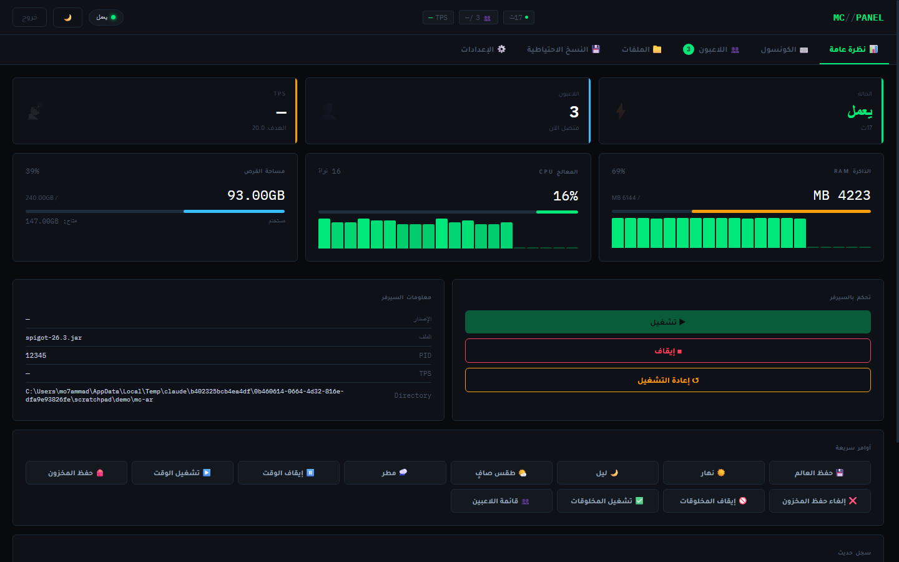

**الكونسول**

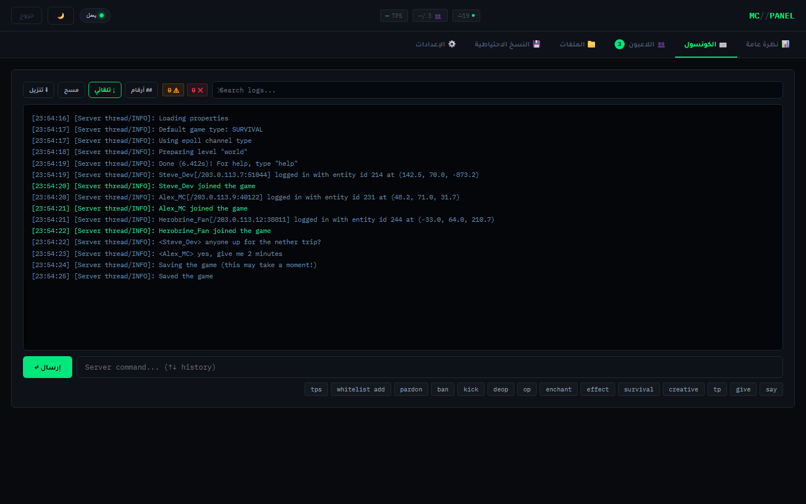

**اللاعبون**

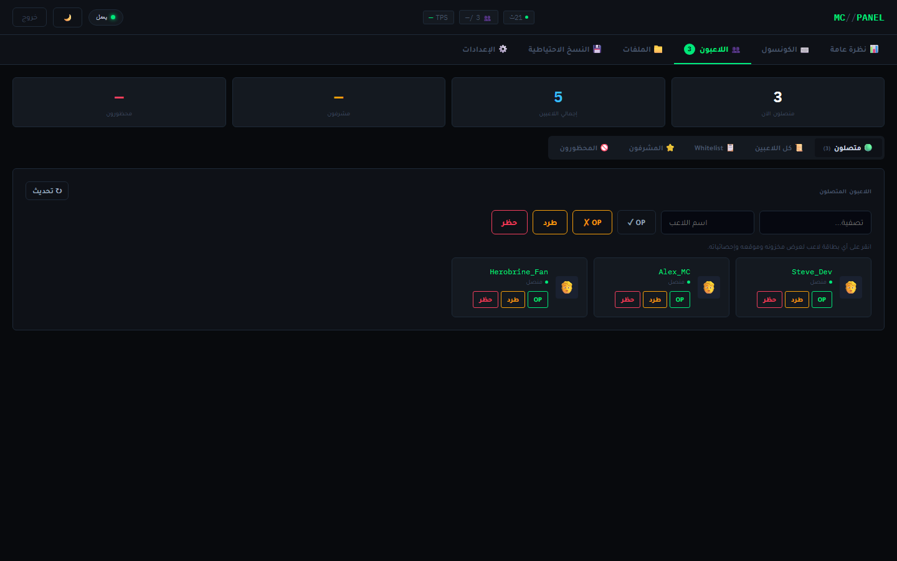

**تفاصيل اللاعب: الصحة والخبرة**

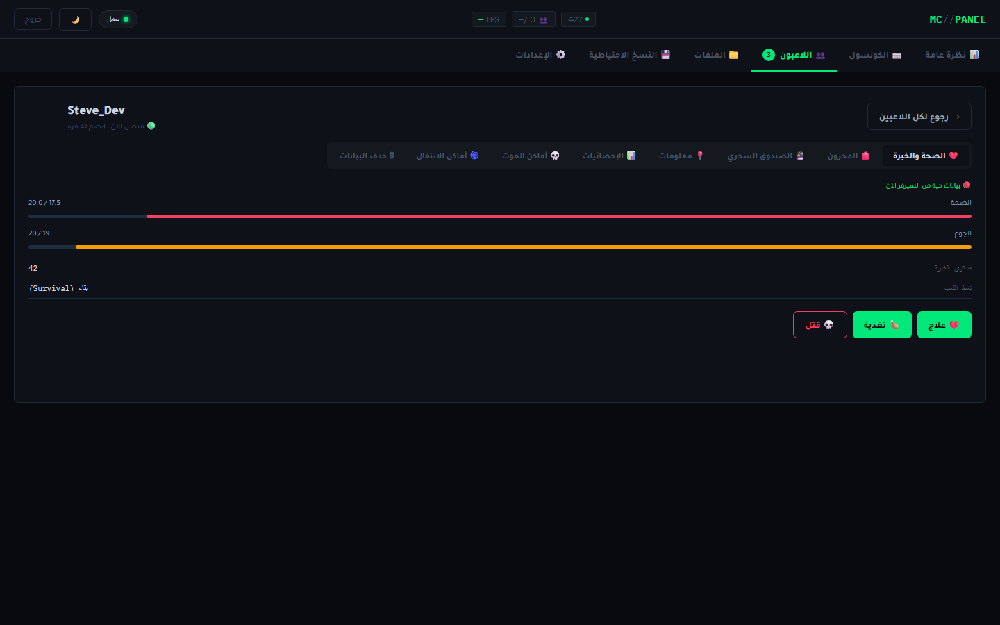

**تفاصيل اللاعب: المخزون**

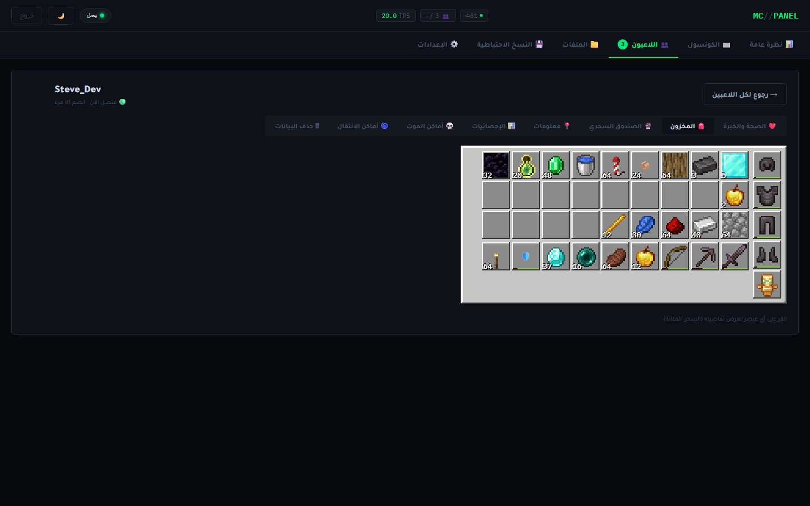

**تفاصيل اللاعب: الإحصائيات**

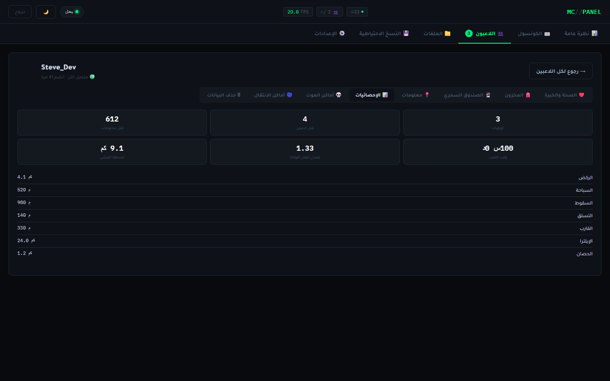

**تفاصيل اللاعب: أماكن الموت**

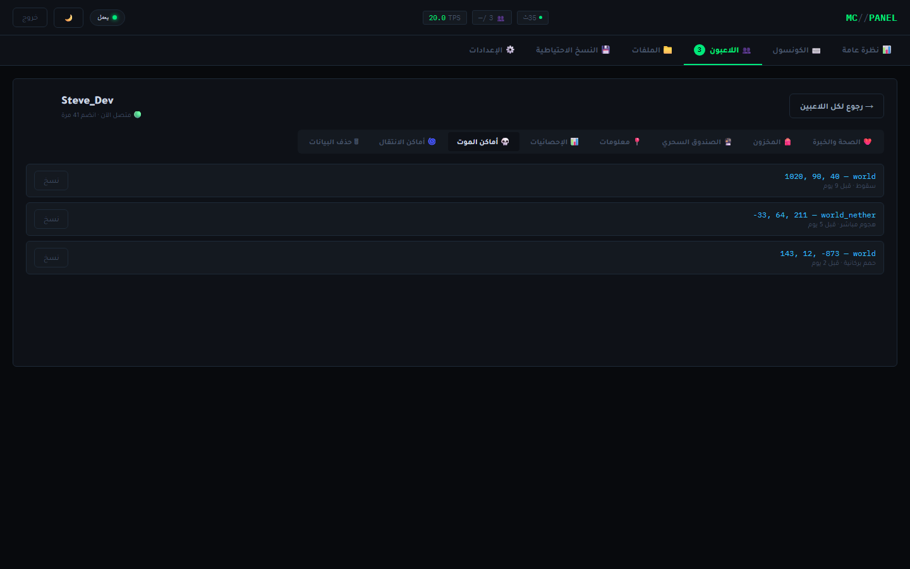

**مدير الملفات**

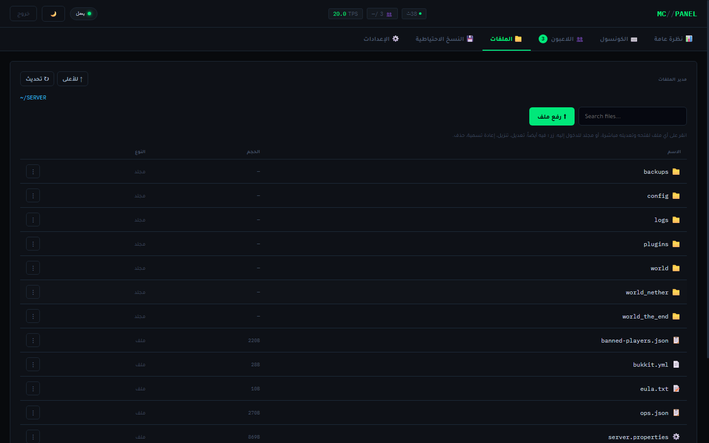

**النسخ الاحتياطية**

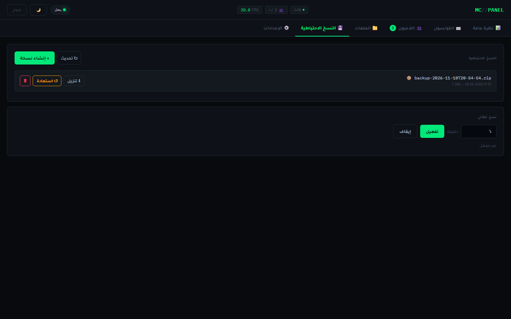

**الإعدادات**

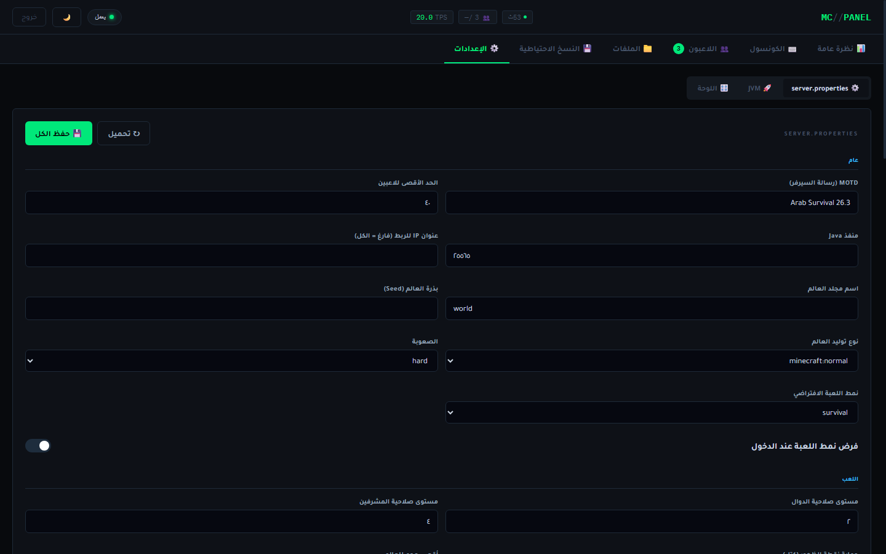

**الوضع الفاتح**

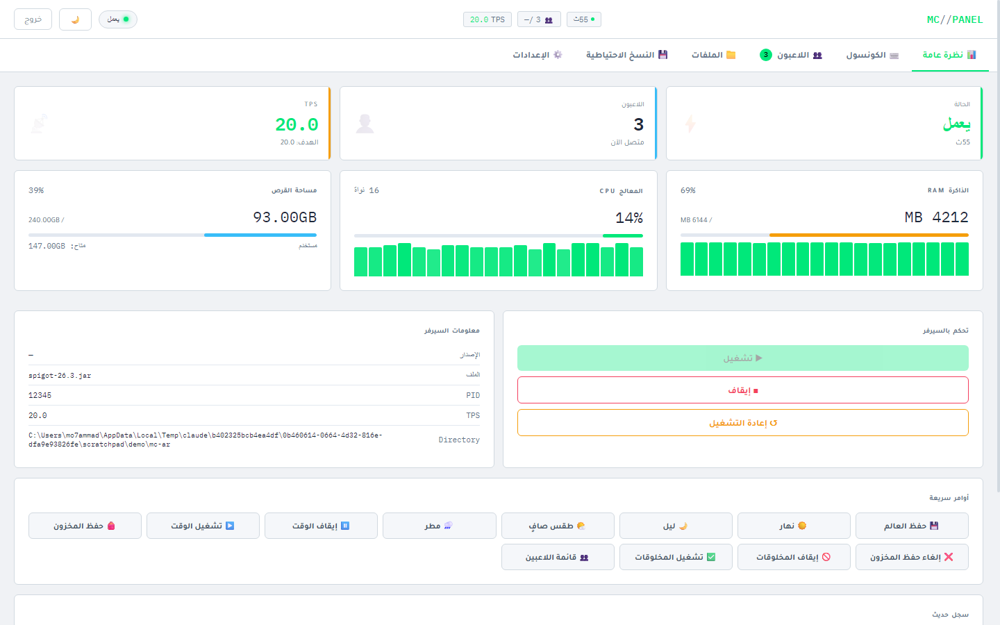

## ملاحظات أمنية

اللوحة تعطي تحكم كامل بالسيرفر: تشغيل وإيقاف، حذف ملفات، تنفيذ أوامر console. لا تعرّض المنفذ مباشرة على الإنترنت. الأفضل reverse proxy (nginx أو Caddy) مع شهادة HTTPS فوقه، أو تقييد الوصول بجدار ناري أو VPN.

الكوكيز مضبوطة بـ `httpOnly` و`sameSite: strict`، لكن بدون `secure` صريح في الكود. الحماية الكاملة تحتاج HTTPS فعليًا في طبقة الـ reverse proxy.

غيّر `ADMIN_PASS` الافتراضي قبل أي استخدام حقيقي. فلترة الأوامر ومدير الملفات فيهم حماية من path traversal وحقن الشل، لكن هذا لا يغني عن تقييد من يوصل للوحة أساسًا.

## الرخصة

MIT، انظر ملف `LICENSE`.
